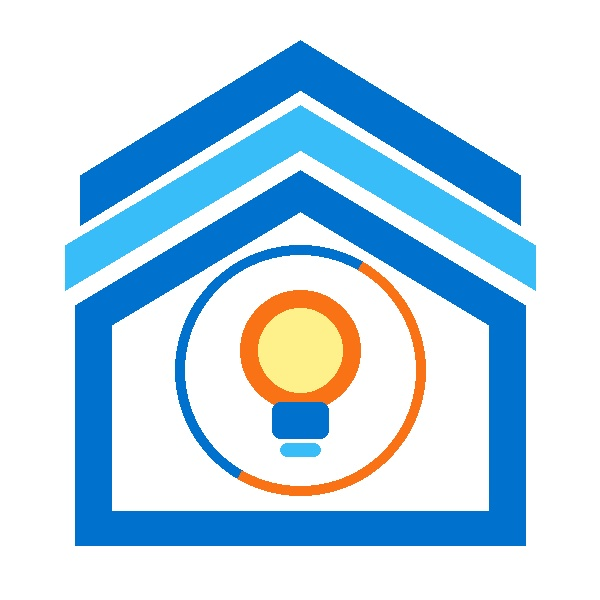
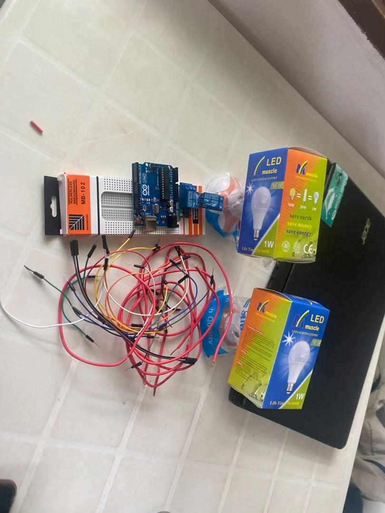
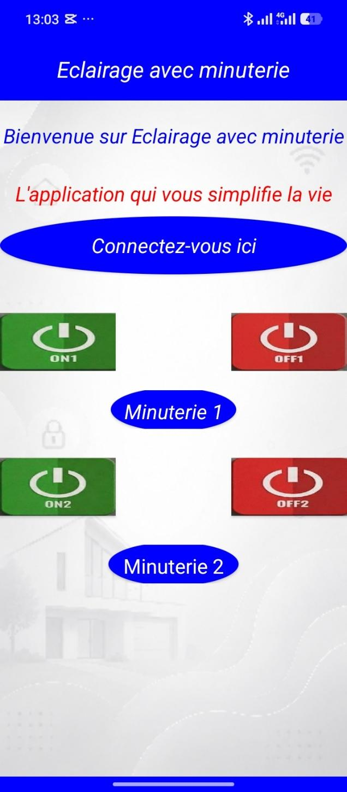
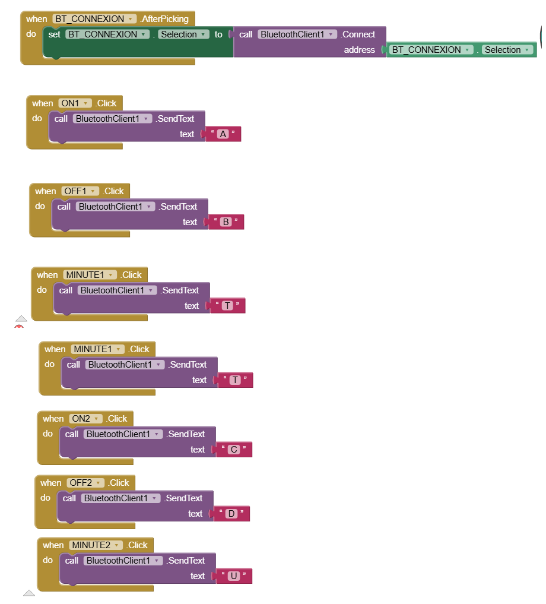
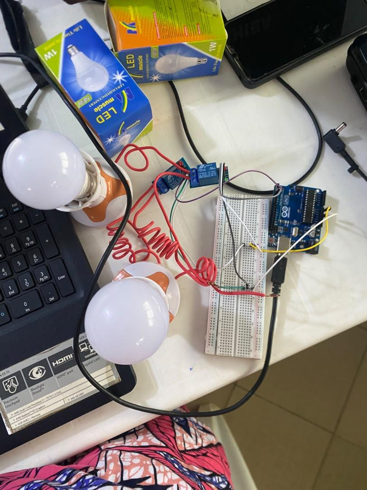
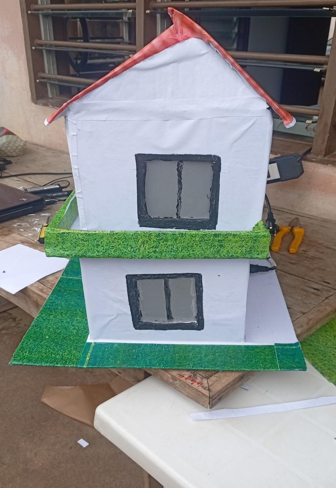
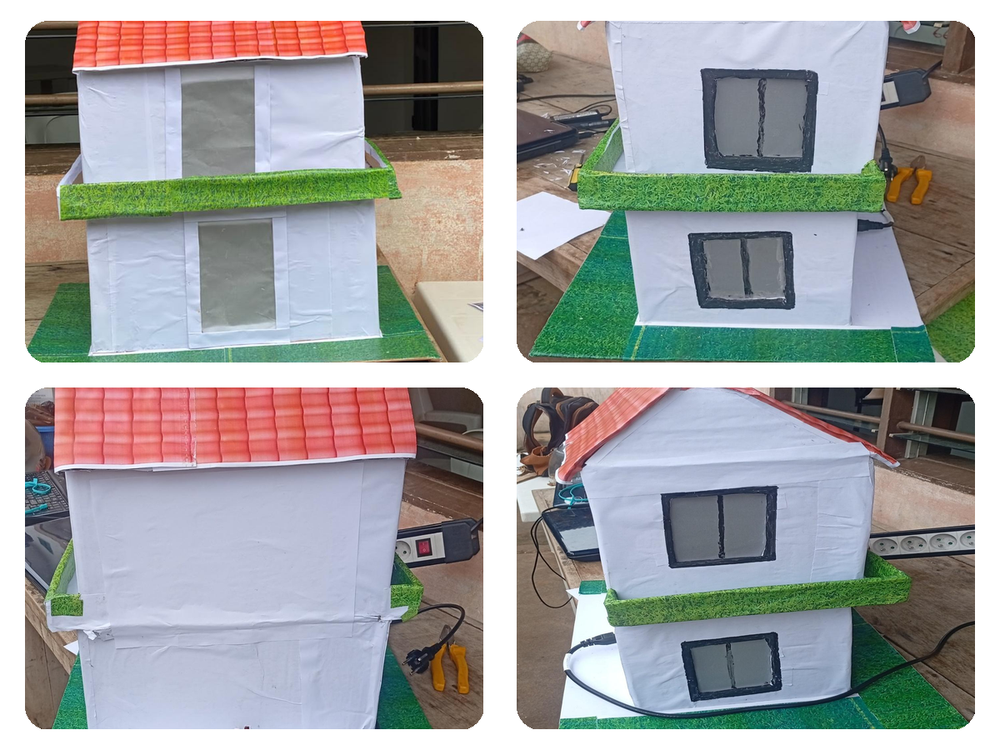

<div align="center">
  
  <br/><br/>
  <h1>CENTRALE DOMOTIQUE D'ÉCLAIRAGE AVEC FONCTION MINUTERIE TEMPORISÉE</h1>
  <h3>Maison intelligente à étage (éclairage intérieur sur deux niveaux) pilotée via Bluetooth</h3>
  <p>
    <strong>Projet n°12 : HOUNMENOU Martial · AGBANRIN Ishola · HOUANSOU Régis A.</strong><br/>
    <em>Formation Professionnelle Max_Adis 2026 · Porto-Novo, Bénin</em>
  </p>
  <p>
    <a href="https://maxadis-domotique-eclairage.vercel.app/" target="_blank"></a>
    <a href="docs/Rapport_Projet_Centrale_Domotique_Eclairage_Minuterie.pdf"></a>
  </p>
  <p>
    <a href="https://github.com/maxadis-formation/CENTRALE-DOMOTIQUE-ECLAIRAGE-MINUTERIE"></a>
    <a href="https://github.com/maxadis-formation/CENTRALE-DOMOTIQUE-ECLAIRAGE-MINUTERIE"></a>
    <a href="https://github.com/maxadis-formation/CENTRALE-DOMOTIQUE-ECLAIRAGE-MINUTERIE"></a>
    <a href="https://github.com/maxadis-formation/CENTRALE-DOMOTIQUE-ECLAIRAGE-MINUTERIE"></a>
    <a href="https://github.com/maxadis-formation/CENTRALE-DOMOTIQUE-ECLAIRAGE-MINUTERIE"></a>
  </p>
</div>

> 🌐 **Accéder au Site Web & Simulateur Interactif en Ligne :** [https://maxadis-domotique-eclairage.vercel.app/](https://maxadis-domotique-eclairage.vercel.app/)

<br/>

## 1. Présentation Générale du Projet

Aujourd'hui, la domotique est au cœur de nos maisons intelligentes. Elle vise à améliorer notre confort, à renforcer la sécurité et surtout à réaliser des économies d'énergie substantielles.

C'est dans ce contexte que s'inscrit ce projet intitulé : **Centrale Domotique d'Éclairage avec Fonction Minuterie Temporisée**, intégré dans une **maquette de maison intelligente à étage (éclairage intérieur sur deux niveaux)**.

Ce système permet à l'utilisateur de piloter à distance deux circuits d'éclairage 220V (Niveau 1 : Rez-de-chaussée & Niveau 2 : Étage supérieur) depuis son smartphone via **Bluetooth (HC-05 / HC-06)**, en mode manuel (**ON / OFF**) ou avec une fonction d'**extinction automatique temporisée (Minuterie de 10 secondes)**. Ainsi, plus besoin de se déplacer la nuit dans les escaliers pour éteindre ou de craindre d'oublier une lampe allumée en quittant une pièce.

### Arborescence du Dépôt

```text
📁 CENTRALE-DOMOTIQUE-ECLAIRAGE-MINUTERIE/
├── 📁 assets/                 # Ressources multimédias, schémas & photos de la maison à étage
├── 📁 docs/                   # Rapport PDF officiel & cahier des charges
│   └── 📄 Rapport_Projet_Centrale_Domotique_Eclairage_Minuterie.pdf
├── 📁 firmware/               # Code source embarqué Arduino (.ino)
│   └── 📄 CODE_FINAL.ino
├── 📄 .gitignore              # Fichiers ignorés standard
├── 📄 index.html              # Site web vitrine & simulateur interactif (2 niveaux + minuteries)
├── 📄 robots.txt              # Directives d'indexation pour robots Google/Bing
├── 📄 sitemap.xml             # Plan de site XML pour indexation moteurs de recherche
└── 📄 README.md               # Documentation technique complète
```

---

## 2. Problématique du Projet

L'éclairage représente une part importante de notre consommation électrique domestique et professionnelle. Cependant, nous avons tous déjà oublié une lampe allumée en quittant une pièce ou un étage, ou nous sommes levés la nuit uniquement pour aller éteindre un interrupteur.

Les installations électriques classiques nécessitent une action physique directe sur chaque interrupteur mural :
* Gaspillage d'énergie électrique par oubli d'extinction ;
* Inconfort lors des déplacements nocturnes entre le rez-de-chaussée et l'étage ;
* Usure prématurée des ampoules laissées allumées inutilement ;
* Absence de contrôle centralisé à distance.

> **Question principale :**  
> *« Comment concevoir un système domotique simple, accessible et fiable, qui permette de piloter l'éclairage intérieur d'une maison à étage à distance via smartphone et qui intègre une fonction d'extinction automatique temporisée pour éviter le gaspillage d'énergie ? »*

---

## 3. Objectifs du Projet

### Objectif Général
Concevoir une centrale domotique d'éclairage intérieur pour une maison intelligente sur deux niveaux, contrôlable à distance par Bluetooth avec fonction de minuterie temporisée.

### Objectifs Spécifiques
* Concevoir une maison intelligente à étage (maquette sur deux niveaux) contrôlable à distance ;
* Piloter indépendamment deux lampes 220V (Circuit 1 Rez-de-chaussée & Circuit 2 Étage) en mode ON/OFF ;
* Intégrer une fonction de minuterie temporisée (10 secondes) avec extinction automatique sur chaque niveau ;
* Offrir une interface mobile intuitive (*« Eclairage avec minuterie »*) et un simulateur web interactif ;
* Fonctionner de manière 100 % autonome en réseau local Bluetooth (portée d'environ 10 mètres) sans dépendre d'une connexion Internet.

---

## 4. Fonctionnement du Système

Le système repose sur **3 grandes phases** (Commande, Transmission/Traitement, Action) déclinées en étapes coordonnées :
1. **Connexion Bluetooth :** L'utilisateur ouvre l'application Android *« Eclairage avec minuterie »* et se connecte au module Bluetooth HC-05 / HC-06.
2. **Envoi d'un ordre :** L'utilisateur appuie sur l'un des 6 boutons de l'interface (`ON1`, `OFF1`, `Minuterie 1`, `ON2`, `OFF2`, `Minuterie 2`).
3. **Transmission sans fil :** L'application transmet instantanément le caractère associé (`A`, `B`, `T`, `C`, `D` ou `U`) par liaison série Bluetooth (9600 bauds).
4. **Réception & Décodage Arduino :** La carte **Arduino Uno** lit le caractère sur le port `SoftwareSerial(10, 11)`.
5. **Commande Mode Manuel (ON/OFF) :**
   * Caractère `A` (`ON1`) → Active le **Relais 1** (`LOW`) pour allumer la lampe du Rez-de-chaussée.
   * Caractère `B` (`OFF1`) → Désactive le **Relais 1** (`HIGH`) pour éteindre la lampe du Rez-de-chaussée.
   * Caractère `C` (`ON2`) → Active le **Relais 2** (`LOW`) pour allumer la lampe de l'Étage.
   * Caractère `D` (`OFF2`) → Désactive le **Relais 2** (`HIGH`) pour éteindre la lampe de l'Étage.
6. **Commande Mode Minuterie Temporisée (10 secondes) :**
   * Caractère `T` (`Minuterie 1`) → Allume la Lampe 1 pendant exactement **10 secondes** (`10 000 ms`), puis coupe automatiquement le relais.
   * Caractère `U` (`Minuterie 2`) → Allume la Lampe 2 pendant exactement **10 secondes** (`10 000 ms`), puis coupe automatiquement le relais.

---

## 5. Liste des Matériels Utilisés et leur Rôle

| Matériel | Quantité | Rôle & Fonction dans le Projet |
| :--- | :---: | :--- |
| **Carte Arduino Uno** | 1 | Microcontrôleur central qui décode les trames Bluetooth et pilote les relais et minuteries. |
| **Module Bluetooth HC-05 / HC-06** | 1 | Assure la liaison sans fil (portée ~10 m) entre le smartphone Android et l'Arduino. |
| **Modules Relais** | 2 | Interrupteurs électromécaniques isolés commandant les deux circuits 220V en toute sécurité. |
| **Lampes LED 220V (1W)** | 2 | Éclairage intérieur des deux niveaux de la maquette (Rez-de-chaussée & Étage). |
| **Douilles électriques** | 2 | Supports de raccordement sécurisé pour les deux ampoules 220V. |
| **Breadboard (MB-102)** | 1 | Plaque d'essai permettant la distribution d'alimentation et le câblage sans soudure. |
| **Fils de connexion (Jumpers)** | Lot | Assurent les liaisons logiques (5V, GND, RX/TX, D2, D3) et puissance. |
| **Smartphone Android** | 1 | Exécute l'application *« Eclairage avec minuterie »* pour le contrôle à distance. |

<div align="center">
  
</div>

---

## 6. Programmation & Code Source

* **Langage utilisé :** C/C++ (Arduino IDE)
* **Application mobile :** *Eclairage avec minuterie* développée avec **MIT App Inventor**

### Code Source Arduino ([`firmware/CODE_FINAL.ino`](firmware/CODE_FINAL.ino))

```cpp
#include <SoftwareSerial.h>

SoftwareSerial mySerial(10, 11); // RX, TX vers module Bluetooth
const int relay1 = 2;            // Relais 1 : Lampe Niveau 1 (RDC)
const int relay2 = 3;            // Relais 2 : Lampe Niveau 2 (Étage)

void setup() {
  pinMode(relay1, OUTPUT);
  pinMode(relay2, OUTPUT);
  digitalWrite(relay1, HIGH); // État initial : Lampe 1 éteinte
  digitalWrite(relay2, HIGH); // État initial : Lampe 2 éteinte
  Serial.begin(9600);
  while (!Serial) {
    ; // Attente de connexion du port série
  }
  Serial.println("DEMARRAGE DU SYSTEME!");
  mySerial.begin(9600);
  mySerial.println("INITIALISATION !");
}

void loop() {
  if (mySerial.available()) {
    char recu1 = mySerial.read();
    Serial.write(recu1);

    if (recu1 == 'A') { // ON 1
      digitalWrite(relay1, LOW);
      digitalWrite(relay2, HIGH);
    }
    if (recu1 == 'B') { // OFF 1
      digitalWrite(relay1, HIGH);
      digitalWrite(relay2, HIGH);
    }
    if (recu1 == 'C') { // ON 2
      digitalWrite(relay1, HIGH);
      digitalWrite(relay2, LOW);
    }
    if (recu1 == 'D') { // OFF 2
      digitalWrite(relay1, HIGH);
      digitalWrite(relay2, HIGH);
    }
    if (recu1 == 'T') { // TIMER 10 secondes (Lampe 1)
      digitalWrite(relay1, LOW);  // Allume le relais 1
      digitalWrite(relay2, HIGH);
      delay(10000);               // Attend 10 secondes
      digitalWrite(relay1, HIGH); // Éteint automatiquement
      digitalWrite(relay2, HIGH);
    }
    if (recu1 == 'U') { // TIMER 10 secondes (Lampe 2)
      digitalWrite(relay1, HIGH);
      digitalWrite(relay2, LOW);  // Allume le relais 2
      delay(10000);               // Attend 10 secondes
      digitalWrite(relay1, HIGH); // Éteint automatiquement
      digitalWrite(relay2, HIGH);
    }
  }

  if (Serial.available()) {
    mySerial.write(Serial.read());
  }
}
```

### Application Mobile & Blocs MIT App Inventor
<div align="center">
  <table border="0">
    <tr>
      <td align="center">
        
        <br/><strong>Interface « Eclairage avec minuterie »</strong>
      </td>
      <td align="center">
        
        <br/><strong>Blocs logiques MIT App Inventor (Commandes A, B, T, C, D, U)</strong>
      </td>
    </tr>
  </table>
</div>

---

## 7. Cas d'Utilisation

La centrale domotique d'éclairage sur deux niveaux peut être déployée dans :
* **Maisons d'habitation & Duplex :** Contrôle de l'éclairage du salon (RDC) et des chambres/couloirs (étage) depuis son lit, avec minuterie de 10 secondes pour traverser un couloir ou monter un escalier sans laisser la lumière allumée.
* **Entreprises & Bureaux :** Extinction centralisée et temporisation des zones de passage (archives, salles de stockage).
* **Boutiques & Commerces :** Pilotage à distance des enseignes ou vitrines et économie d'énergie électrique garantie.

---

## 8. Étapes de Réalisation du Projet

1. **Étape 1 : Montage électronique & câblage des 2 circuits 220V** (Interfaçage de l'Arduino Uno, de la breadboard, du module Bluetooth et des 2 relais reliés aux 2 douilles et ampoules LED).
2. **Étape 2 : Création de l'interface de l'application mobile** (Design de l'écran d'accueil *« Eclairage avec minuterie »* avec bouton d'appairage Bluetooth, boutons `ON1`/`OFF1`, `Minuterie 1`, `ON2`/`OFF2` et `Minuterie 2`).
3. **Étape 3 : Programmation des blocs MIT App Inventor & du code Arduino** (Association de chaque bouton aux trames `A`, `B`, `T`, `C`, `D`, `U` et implémentation de la temporisation de 10 000 ms).
4. **Étape 4 : Fabrication et finalisation de la maquette de maison à étage** (Construction d'une maison sur deux niveaux avec toit rouge, balcon gazonné, fenêtres sur chaque étage et intégration interne des deux lampes).

<div align="center">
  <table border="0">
    <tr>
      <td align="center">
        
        <br/><strong>Étape 1 : Montage Électronique & Lampes 220V</strong>
      </td>
      <td align="center">
        
        <br/><strong>Étape 4 : Maquette de Maison Intelligente sur 2 Niveaux</strong>
      </td>
    </tr>
  </table>
</div>

---

## 9. Tests du Système et Validation Fonctionnelle

| Test Réalisé | Description & Comportement Observé | Résultat |
| :--- | :--- | :--- |
| **Appairage Bluetooth** | Connexion stable entre l'application Android et le module Bluetooth jusqu'à ~10 mètres | **Validé** |
| **Commande Niveau 1 (RDC)** | Allumage immédiat sur `ON1` (trame `A`) et extinction sur `OFF1` (trame `B`) | **Validé** |
| **Commande Niveau 2 (Étage)** | Allumage immédiat sur `ON2` (trame `C`) et extinction sur `OFF2` (trame `D`) | **Validé** |
| **Minuterie Temporisée 1 (10s)** | La lampe 1 s'allume dès réception de `T` et s'éteint automatiquement après 10 secondes | **Validé** |
| **Minuterie Temporisée 2 (10s)** | La lampe 2 s'allume dès réception de `U` et s'éteint automatiquement après 10 secondes | **Validé** |
| **Isolation & Sécurité 220V** | Commutation franche des deux charges 220V via les relais sans échauffement | **Validé** |

---

## 10. Présentation de la Maquette Finale (Maison Intelligente à Étage)

<div align="center">
  
</div>

---

## 11. Conclusion, Difficultés et Perspectives

### Difficultés Rencontrées et Résolues
* Mise au point du code Arduino pour synchroniser les commandes des deux relais et les temporisations de 10 secondes (résolue grâce à l'accompagnement du formateur) ;
* Intégration sécurisée des deux circuits d'éclairage 220V à l'intérieur des deux niveaux de la maquette.

### Perspectives d'Évolution
* Ajouter un **retour d'état en temps réel** sur l'application mobile pour connaître l'état de chaque lampe à tout moment ;
* Rendre la **durée de la minuterie réglable** depuis l'application mobile (ex: 10s, 1 min, 5 min, 30 min) et utiliser `millis()` pour un décompte non-bloquant ;
* Augmenter le **nombre de canaux** pour piloter davantage de pièces de la maison ;
* Migrer vers un module **ESP32 (Wi-Fi + Bluetooth)** pour contrôler la maison à distance via Internet.

---

## 12. Équipe du Projet & Mentions Légales

Projet réalisé par l'équipe du **Projet n°12** :
* **HOUNMENOU Martial** — Concepteur & Développeur Système Embarqué
* **AGBANRIN Ishola** — Concepteur & Intégrateur Domotique
* **HOUANSOU Régis A.** — Concepteur & Développeur Application Mobile

* **Organisation & Mentorat :** Centre de formation **Max_Adis** (*« Crée et contrôle tes propres systèmes intelligents »*) — Édition 2026.
* **Lieu :** Porto-Novo, Bénin.

---

## 13. Contact, Support & Accompagnement de Projets

Vous souhaitez concevoir ou réaliser un projet similaire en **domotique, IoT, systèmes embarqués ou électronique** ? Vous avez besoin d'une assistance technique ou d'un accompagnement sur-mesure pour vos prototypes et formations ?

* **Email :** [maxadisorg@gmail.com](mailto:maxadisorg@gmail.com)
* **Téléphone / WhatsApp :** [+229 01 54 11 64 25](tel:+2290154116425)
* **Organisation GitHub :** [https://github.com/maxadis-formation](https://github.com/maxadis-formation)
* **Dépôt Officiel du Projet :** [https://github.com/maxadis-formation/CENTRALE-DOMOTIQUE-ECLAIRAGE-MINUTERIE](https://github.com/maxadis-formation/CENTRALE-DOMOTIQUE-ECLAIRAGE-MINUTERIE)

> *« Vos avis et retours comptent énormément ! N'hésitez pas à nous écrire pour toute suggestion d'amélioration ou collaboration. »*
